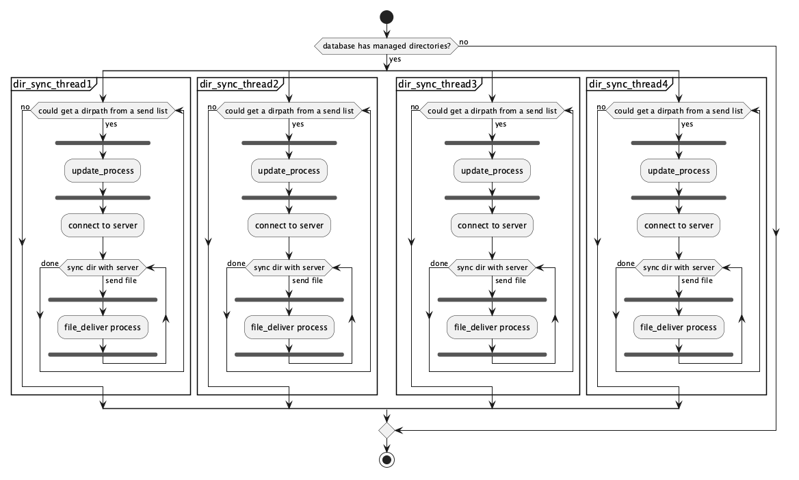
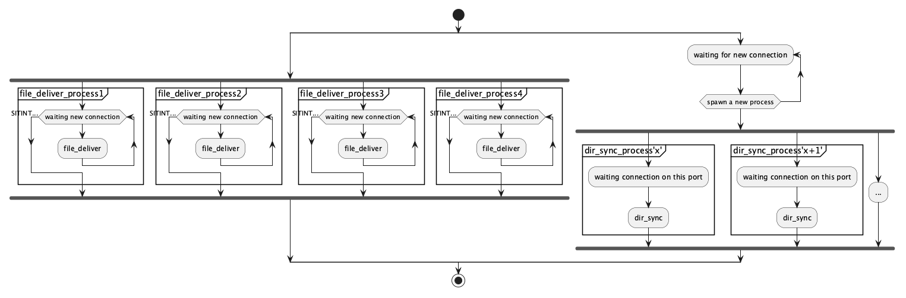
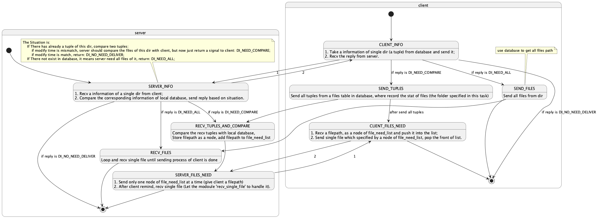

# Lurk

Lurk is a High-Performence, Open-Source, C/C++ system utility designing for arbitrary discrete directories and generating verification files to perform block-level comparison.

Lurk aims to reach the fastest speed, at the same time, minimizing resource overhead of comparing within delivering process of large file.

It is running at system level, and now support Unix (macos), also linux windows version comes later in the first offical verison, it ultimately aims to empower users to manage personal files in all personal machines.

The documents of lurk is writing now alongside the development of lurk. The part of document could be found in Technical Architecture  section.

> [!WARNING]
>
> Lurk is decided to transferring to c++11 verision, which use RAII、try-catch and other c++ feasures. At the first time, it is ALL written in C, so the code may be a little mess.
> The repo used to stores the change during transferring process.

## Feasures

- Discrete directory free arrangement and management. The directory could be any folders in your operating system, the premise being only the readability of the directories and files;

- A high-throughput architecture based on shared memory (mmap). Using POSIX shared memory and combining distributed read-concentrated write for transmission and reception, skipping the user state to achieve zero-copy speed, and also trying to optimize resource reduction while maximizing transmission throughput.

- Using UNIX domain sockets for local transmission and TCP sockets for network transmission;

- A high-concurrency mixed multi-threading and multi-process model with security, where multi-threading is mainly used for tasks such as comparing directory items and generating verification files, which are I/O intensive. Due to the uncertainty and risk of file reading/writing, multi-process is used to ensure the safety of the main process and manage them using the same process group.

- Independent multi-threaded directory verification file update process, performs a depth-first traversal of the directories to be sent, generates a verify file for each eligible file using the sha256 algorithm (which should be replaced as i develop a new algorithm), and simultaneously uses a producer-consumer model to ensure that there are 4 independent checksum file generation threads running concurrently, accelerating I/O-intensive tasks.

- Transaction fault tolerance ensures that the receiving party's database updates the file tuple to a specific table only when the file deliver is successful, and only updates the directory tuple to a specific table when all files in the directory have delivered successfully, to ensure state consistency.

- Resuming transfer. If the file transfer is interrupted, independent file transfer processes will perform a complete comparison to determine the required file blocks.

- Defensive read-only design and non-destructive transmission, with the sender adopting a strict read-only mode, making no modifications, and reading all file data only in kernel mode during transmission, which will be modified in the user mode.

- ...

- > [!NOTE]
  >
  > Next: Use launchd, systemd daemons to run silently; 
  >
  > supports automatic backup when disk tools are inserted, and performs incremental synchronization based on the characteristics of this project.

## Usage

 Lurk provides a unix bash shell script to  use.

FIrst, add your directory to lurk-client. You should pass Absolute Path.

```shell
lurk-client --set-dirs /path/to/your/dir1 /path/to/your/dir2 ...
```

Then, use lurk-server to start, but the precondition is  you have already hand off a receive_dir to lurk-server-init process to generate yaml file stored as ~/.config/lurk/lurk_server_config.yaml in client machine :

```shell
shell>> lurk-server --init /path/to/your/recv/dir
Init server environment success.
You should paste this content to your client config file (~/.config/lurk/lurk_server_config.yaml):
server_ip : 127.0.0.1
server_port: 59346
server_deliver_file_port1: 59347
server_deliver_file_port2: 59348
server_deliver_file_port3: 59349
server_deliver_file_port4: 59350
```

Paste it into your config file. If the config file has data, remove all of it.

Now ~/.config/lurk/lurk_server_config.yaml in your client machine looks like this:

```yaml
server_ip : 127.0.0.1
server_port: 59346
server_deliver_file_port1: 59347
server_deliver_file_port2: 59348
server_deliver_file_port3: 59349
server_deliver_file_port4: 59350
```

But the ports provided by lurk-server is calculated in real time, and there may be a limit time in your system to occupy them (1min or more), otherwise the other programs will occupy them, so you should use this command to run lurk-server which could keep occupying these ports:

```shell
lurk-server --sync
```

After running lurk-server, you should run client to sync, which script is:

```shell
lurk-client --sync
```

Until this time, lurk-client and lurk-client needs manul control. You should pay attention to the standard output of lurk-client, not the server.

## Requirements

Currently, Lurk compiles and runs successfully by 64-bit macos. 

Cross-Platform support for linux and windows is under active development, spanning both 32-bit and 64-bit operating system.

## Progress

you will soon notice new update about lurk as follow feasures:

- [ ] UNIX Domain socket

- [ ] Transfer to C++ 11

- [ ] Daemon Process

- [ ] ....

## Technical Architecture & Design Details

### Architecture

lurk_client consists of [ __lurk_client_process__, __lurk_update_process__, __lurk_single_file_process__ ]. When lurk_client is used to send dirs, the lurk_client_process is the first process to called. lurk_client_process acts as a 'dispatcher', routing a dirpath recorded in client database to lurk_update_process to insert the information of files upon this dirpath and generate verify files of them, calling a sender to sync dirs with lurk_server after lurk_update_process is done, and invoking lurk_client_single_file_deliver_process to deliver the file needed by lurk_server. lurk_client_process loops this process to send all directories and all files of them to lurk_server.

lurk_server consists of [ __lurk_server_process__, __lurk_server_dir_sync_process__, __lurk_server_single_file_deliver_process__ ]. lurk_server_process pre-creates several lurk_server_single_file_deliver_process to listening connection of single file deliver request autonomously. The pre-created process is very independent of other processes that the deliver_process has a complete process to receive files, including compare files, send which block he needs, and receive blocks. While a connection to lurk_server_process arrives, server will create a new process which called lurk_server_dir_sync_process in order to deal a connection from lurk_client, and sync the directory which is specified by lurk_client. If lurk_client determines that server need that file, client will invode file deliver process to send specified file to lurk_server_single_file_process, which involved connect-accept with send-recv process even compare the files to make sure the safty and speed.

> |[!NOTE]
>
> Both server and client processes are assigned to their respective process groups to facilitate more convenient signal handling and more graceful termination.
>
> e.g. "kill -9 -<pid>" could kill all processes of client or server.


lurk_client_process reads all directories from a table in database (Sender_map_table) and pushes their paths to a forward-list, then create 4 threads (now it is fixed value/thread pool size) to consume the list; Each thread passes its dirpath geted to the update process to generate verify file. Update process traverse all the files upon the specified dirpath, make verify file and update database (table_xxxxx…​) at the same time. After update, thread connects to the server, via a port pre-speicified by server. When thread sync files with server, it spawns a new process and hands off the filepath to file_deliver_process.



lurk_server_process acts like this:



dir_sync_process acts like this:



single_file_deliver_process acts like this:

> [!NOTE]
>
> Making now..

## Performance Test

test machine: MacBook 14inch with Apple m1 pro, darwin23.6.0.

| test objects | test | s   |
| ------------ | ---- | --- |
|              |      |     |
|              |      |     |
|              |      |     |

## Test Matrix

### Dir Sync Test

| Attribute        | Test conditions                                                                                                                                                                                                                                                                                                                                                                                                         | Result                                                                                                                        |
| ---------------- | ----------------------------------------------------------------------------------------------------------------------------------------------------------------------------------------------------------------------------------------------------------------------------------------------------------------------------------------------------------------------------------------------------------------------- | ----------------------------------------------------------------------------------------------------------------------------- |
| Positive Example | 1. Run with a Test Stub: recv_single_file() and send_single_file() always return true; <br/> 2. Sender's database file is in the local send folder, which already exists the dir information and file information; <br/> 3. Do not Create Receiver's database file;                                                                                                                                                     | PASSED. <br/>Receiver receive all tuples of tables from Sender, update all tables.                                            |
| Negative Example | 1. Run with a Test Stub: recv_single_file() and send_single_file() always return false; <br/>2. Sender's database file is in the local send folder, which has already exist the dir information and file information; <br/>3. Do not Create Receiver's database file;                                                                                                                                                   | PASSED.<br/>Receiver create database file and corresponding tables, but all tuples from Sender is not update in local tables. |
| Positive Example | 1. Run with a Test Stub: recv_single_file() and send_single_file() always return true; <br/>2. Sender's database file is in the local send folder, which already exists the dir information and file information; <br/>3. Receiver's database file also in the local recv folder, but the tuples in tables is not consistent with Sender's, include modify time in dir tuples, modify time and file size in file tuples | PASSED. <br/>Receiver update table success.                                                                                   |

### Lurk Client & Lurk Server Test

| Attribute        | Test conditions                                                                                                                                               | Result                                                                                                                                                                                                                                                                                              |
| ---------------- | ------------------------------------------------------------------------------------------------------------------------------------------------------------- | --------------------------------------------------------------------------------------------------------------------------------------------------------------------------------------------------------------------------------------------------------------------------------------------------- |
| Positive Example | 1. Run with a Test Stub: Sync_dir_sender::sync_start() and Sync_dir_receiver::sync_receiver() always return true; <br/>2. No tuple in Sender_map_table.       | PASSED. <br/>1. client create 0 threads to send, and exactly denotes that dir table has no data; <br/>2. server is waiting, but get no connection.                                                                                                                                                  |
| Positive Example | 1. Run with a Test Stub: Sync_dir_sender::sync_start() and Sync_dir_receiver::sync_receiver() always return true; <br/>2. several tuples in Sender_map_table. | PASSED.<br/>1. client do create max count threads, all threads make a connection with a process of server;<br/>2. server accept all connection, and create processes; all processes are exit success.                                                                                               |
| Negative Example | 1. Run with a Test Stub: Sync_dir_sender::sync_start() and Sync_dir_receiver::sync_receiver() always return false;<br/>2. several tuples in Sender_map_table. | PASSED. <br/>1. client do create max count threads, and all threads make a connection with a process of server.<br/>2. server accept all connection, and create processes; all processes are exit success.<br/>3. but either the send_thread in client or recv_process in client are return failed; |

### Set Dir & Update Dir Test

| Attribute        | Test Conditions                                                                                                       | Result                                                |
| ---------------- | --------------------------------------------------------------------------------------------------------------------- | ----------------------------------------------------- |
| Positive Example | 1. Set a non-empty dirs to make verify file and update tables;<br/>2. Dir has over 100 Files.                         | PASSED.<br/>All verify files calculated successfully. |
| Positive Example | 1. Set a non-empty dirs to make verify file and update tables;<br/>2. Dir has one file, which size is more than 15GB. | PASSED.<br/>Verify files calculated successfully.     |
